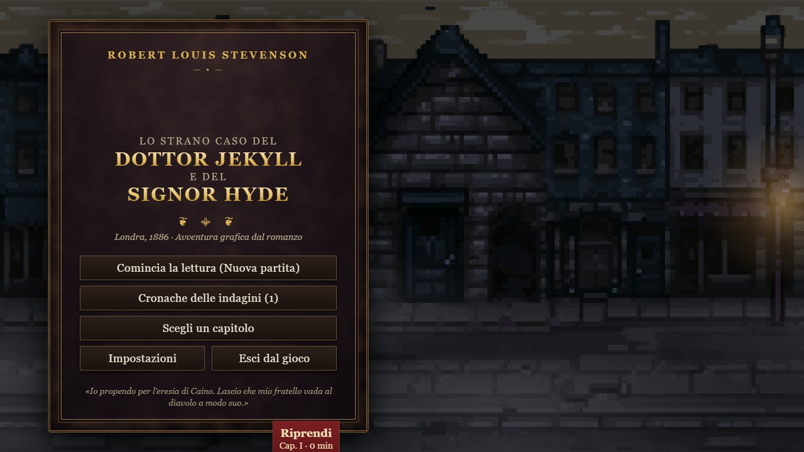
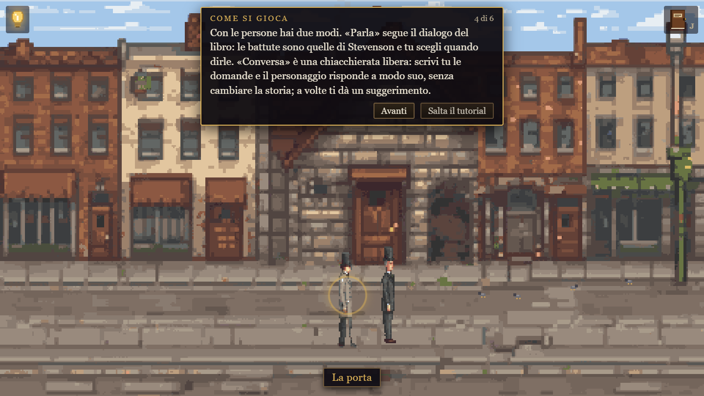
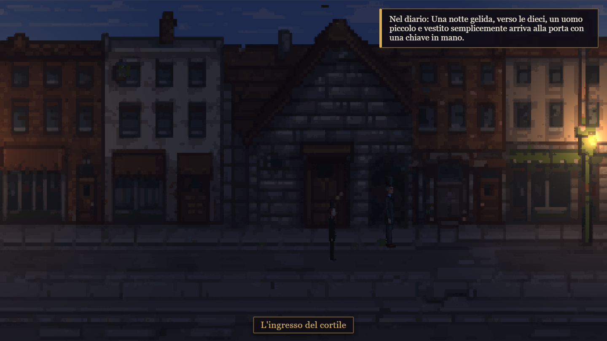
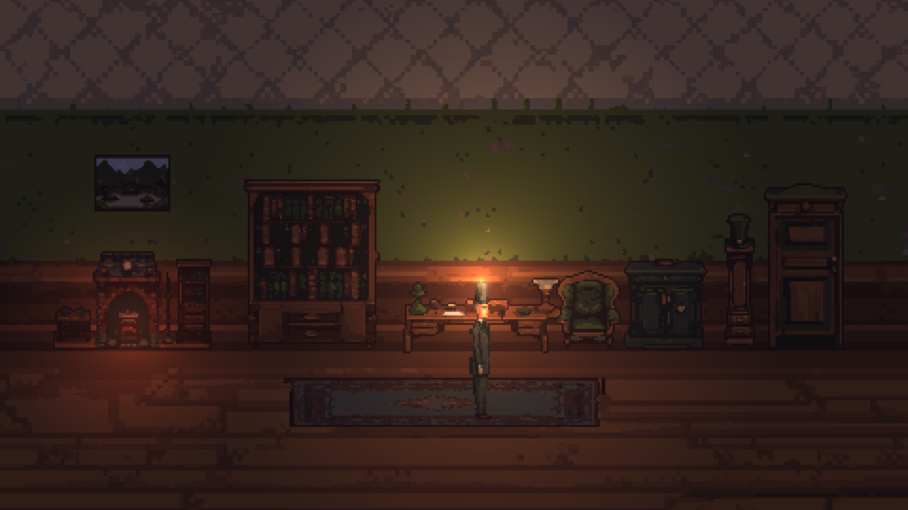
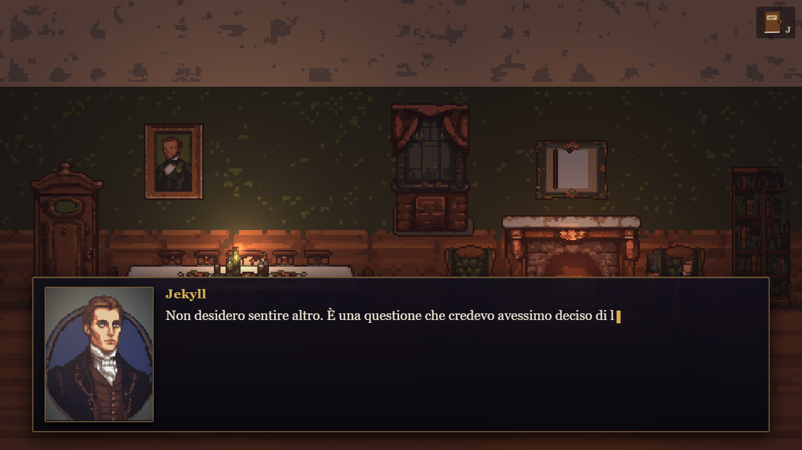
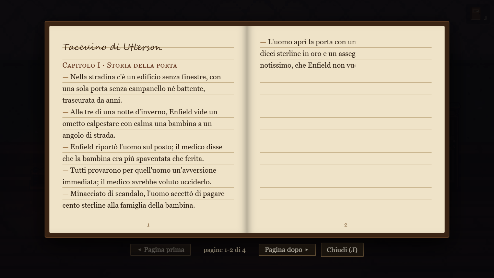
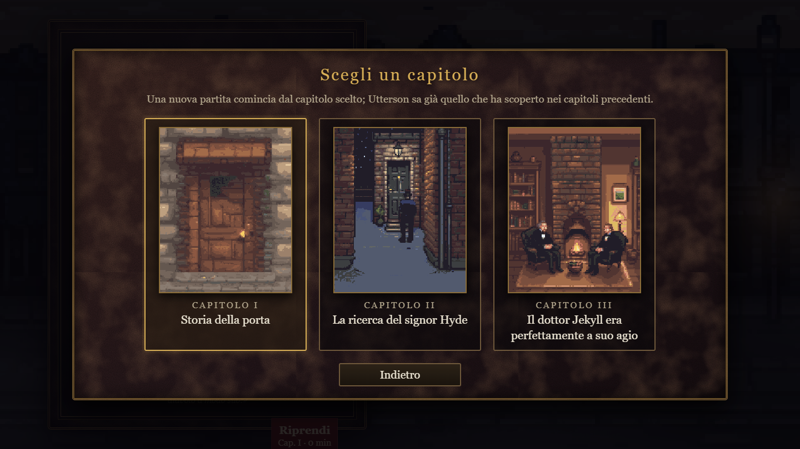

# Lo strano caso del dottor Jekyll e del signor Hyde

Un'avventura grafica punta-e-clicca in pixel art, in italiano, che racconta fedelmente il romanzo di
Robert Louis Stevenson (1886). Sei l'avvocato Utterson: cammini per la Londra vittoriana, osservi, ascolti,
annoti, e un passo alla volta ti avvicini al segreto del tuo amico, il dottor Jekyll.

Le battute dei dialoghi sono quelle del libro. Con i personaggi puoi anche parlare liberamente: un modello di
linguaggio che gira sul tuo computer, senza internet, risponde nei loro panni senza mai cambiare la storia.

> **Versione 0.1: i capitoli I-III di dieci.** Il resto è in lavorazione.



## Scarica e gioca

**[Scarica l'ultima versione](https://github.com/fabiopsh/Jekyll-e-Hyde/releases/latest)**: in fondo alla pagina,
sotto *Assets*, scegli il file del tuo sistema.

| Sistema | File da scaricare |
|---|---|
| Windows 10 o 11, 64 bit | `Jekyll-e-Hyde-<versione>-Windows-Setup.exe` |
| macOS con chip Apple (M1 e successivi) | `Jekyll-e-Hyde-<versione>-macOS-arm64.dmg` |
| Linux 64 bit: Ubuntu, Debian, Mint | `Jekyll-e-Hyde-<versione>-Linux-amd64.deb` |
| Linux 64 bit: altre distribuzioni | `Jekyll-e-Hyde-<versione>-Linux-x64.AppImage` |

Il pacchetto pesa circa 160 MB. Il gioco non è firmato digitalmente (la firma costa un abbonamento annuale), quindi
al primo avvio Windows e macOS lo trattano con sospetto. I passi qui sotto spiegano come aprirlo.

### Windows

1. Scarica `…-Windows-Setup.exe` e aprilo con un doppio clic.
2. Se compare *Windows ha protetto il PC*, fai clic su **Ulteriori informazioni**, poi su **Esegui comunque**.
3. Segui l'installazione. Se ti chiede per chi installare, scegli *solo per me*: così non servono permessi di
   amministratore.
4. Apri il gioco dal menu Start o dall'icona sul desktop, *Jekyll e Hyde*.

### macOS (chip Apple)

1. Scarica `…-macOS-arm64.dmg`, aprilo e trascina *Jekyll e Hyde* nella cartella **Applicazioni**.
2. Apri il gioco da Applicazioni. La prima volta macOS lo blocca perché non viene da uno sviluppatore registrato.
3. Apri **Impostazioni di Sistema → Privacy e sicurezza**, scorri fino al messaggio su *Jekyll e Hyde* e fai clic
   su **Apri comunque**; conferma.
4. Se invece macOS dice che l'app *è danneggiata*, apri il Terminale e scrivi questo comando, che toglie il
   contrassegno "scaricato da internet" messo da macOS sul file:

   ```bash
   xattr -dr com.apple.quarantine "/Applications/Jekyll e Hyde.app"
   ```

I Mac con processore Intel non sono supportati in questa versione.

### Linux

Con Ubuntu, Debian o Mint usa il pacchetto `.deb`:

```bash
sudo apt install ./Jekyll-e-Hyde-<versione>-Linux-amd64.deb
```

Poi apri *Jekyll e Hyde* dal menu delle applicazioni.

Con altre distribuzioni usa l'AppImage: rendila eseguibile e avviala.

```bash
chmod +x Jekyll-e-Hyde-<versione>-Linux-x64.AppImage
./Jekyll-e-Hyde-<versione>-Linux-x64.AppImage
```

Se l'AppImage non parte e cita *FUSE*, installa la libreria `libfuse2` (su Ubuntu 24.04 si chiama `libfuse2t64`).

## La chat libera (facoltativa)

Con i personaggi ci sono due modi di parlare:

- **Parla**: il dialogo del libro. Le battute sono di Stevenson; tu scegli quando dirle.
- **Conversa**: una chiacchierata libera. Scrivi tu le domande e il personaggio risponde a modo suo. Non può
  cambiare la storia né anticiparla; a volte, se sei bloccato, ti dà un suggerimento.

*Conversa* ha bisogno di un modello di linguaggio (Qwen 3.5 4B, licenza Apache 2.0) che non è nel pacchetto,
perché da solo pesa 2,5 GB. Si scarica dal gioco:

1. Nel menu principale fai clic su **Chat libera (IA)**.
2. Fai clic su **Scarica il modello**. Vedi la fase, i GB scaricati, la velocità e il tempo che manca; puoi
   fermare il download con **Stop** e riprenderlo più tardi da dove si era fermato.
3. Alla fine il gioco controlla che il file sia integro. Da quel momento *Conversa* è attiva.

Se sul computer c'è già [Ollama](https://ollama.com) con il modello `qwen3.5:4b`, il gioco usa quello e non scarica
nulla.

Senza il modello *Conversa* resta grigia, e tutto il resto del gioco funziona: storia, dialoghi del libro,
suggerimenti. Il modello usa la scheda video se c'è (tramite Vulkan, quindi NVIDIA, AMD o Intel), altrimenti il
processore, più lentamente. Occupa circa 2,5 GB di memoria mentre giochi. Sul PC di sviluppo si carica in circa
15 secondi e risponde in circa 4; su altri computer non è ancora stato misurato.

## Come si gioca

Alla prima partita un breve tutorial spiega i comandi.

| Comando | Cosa fa |
|---|---|
| Clic sulla strada o sul pavimento | Utterson cammina fin lì |
| Clic su una cosa o una persona | si apre il menu delle azioni: *Osserva*, *Usa*, *Parla*, *Conversa* |
| Clic destro su una cosa | la osserva subito, senza menu |
| Clic, Spazio o Invio | fa avanzare il testo (il primo mostra tutta la frase, il secondo va avanti) |
| J, o il taccuino in alto a destra | il taccuino con gli appunti di Utterson |
| La lampadina in alto a sinistra | cosa fare adesso, e un suggerimento quando è accesa |
| Esc | pausa: volumi, velocità e dimensione del testo, schermo intero |

La partita si salva da sola. Dal menu principale puoi riprendere l'ultima partita (il segnalibro *Riprendi*),
cominciare da un capitolo a scelta e rileggere le *Cronache delle indagini*: per ogni partita, che cosa hai
scoperto, le scelte fatte e le conversazioni.

| | |
|---|---|
|  |  |
|  |  |
|  |  |

## Cosa c'è in questa versione

| Capitolo | Titolo | Stato |
|---|---|---|
| I | Storia della porta | giocabile |
| II | La ricerca del signor Hyde | giocabile |
| III | Il dottor Jekyll era perfettamente a suo agio | giocabile, con un rompicapo |
| IV-X | dall'omicidio Carew alla dichiarazione di Jekyll | in lavorazione |

## Fedeltà al libro

Il gioco segue il romanzo scena per scena. Le battute dei personaggi sono quelle di Stevenson, in una traduzione
italiana preparata per questo progetto: ogni battuta usata nel gioco rimanda alla sua frase originale, e un
controllo automatico verifica che quella frase sia davvero nel testo di Project Gutenberg (eBook #43). Il giocatore sceglie l'ordine, cosa osservare e quando parlare, ma non cambia
quello che accade. Le idee di gioco che non sono nel libro, come il rompicapo del capitolo III, non aggiungono
eventi alla storia. La violenza resta fuori scena.

## Dove sono i salvataggi

| Sistema | Cartella |
|---|---|
| Windows | `%APPDATA%\jekyll-e-hyde` |
| macOS | `~/Library/Application Support/jekyll-e-hyde` |
| Linux | `~/.config/jekyll-e-hyde` |

Lì ci sono le partite (`runs/`) e, se l'hai scaricato, il modello della chat libera (`models/`). Per togliere il
modello usa **Chat libera (IA) → Elimina il modello scaricato** nel menu principale.

## Per chi sviluppa

Servono Node.js 22 e npm.

```bash
npm install
npm run dev
```

Prima di cominciare leggi [`AGENTS.md`](AGENTS.md). Spiega le regole del progetto, che vale anche per chi ci
lavora con un assistente IA, e l'ordine in cui leggere [`docs/STATO.md`](docs/STATO.md),
[`docs/ARCHITETTURA.md`](docs/ARCHITETTURA.md) e [`docs/DECISIONI.md`](docs/DECISIONI.md).

| Comando | Cosa fa |
|---|---|
| `npm run dev` | il gioco in sviluppo |
| `npm test` | i test della logica e dei capitoli giocati da capo a fondo |
| `npm run validate` | controlla i contenuti: riferimenti, battute del libro, spazi e punteggiatura |
| `npm run shot -- <scenario>` | gioca da solo e salva screenshot in `out/shots/` |
| `npm run dist:win` | crea l'installatore Windows in `dist/` (macOS e Linux: `dist:mac`, `dist:linux`, sul loro sistema) |

**Pubblicare una versione.** Le release le costruisce GitHub Actions
([`.github/workflows/release.yml`](.github/workflows/release.yml)), ogni sistema sul proprio:

1. Aggiorna `version` in `package.json` (per esempio `0.2.0`) e il testo della release in
   [`.github/release-notes.md`](.github/release-notes.md).
2. Fai il commit e il push su `main`.
3. Crea e invia il tag con lo stesso numero: `git tag v0.2.0` e poi `git push origin v0.2.0`.
4. Quando il flusso finisce (lo segui nella scheda *Actions*), la pagina *Releases* ha la nuova versione con i
   quattro file. Una versione `0.x` viene pubblicata come *pre-release*.

Dalla scheda *Actions* puoi anche avviare il flusso a mano: costruisce i pacchetti senza pubblicare nulla, per
provarli prima.

## Crediti e licenze

- **Romanzo**: Robert Louis Stevenson, *Strange Case of Dr Jekyll and Mr Hyde* (1886), pubblico dominio; testo da
  Project Gutenberg.
- **Immagini e musica**: generate in locale per questo progetto, con Stable Diffusion XL e il LoRA *Pixel Art XL*
  (immagini) e MusicGen di Meta (musica), poi ritoccate e ridotte alla palette del gioco. Strumenti in
  [`tools/`](tools/).
- **Modello della chat**: Qwen 3.5 4B di Alibaba, licenza Apache 2.0, scaricato dal registro di Ollama.
- **Motore**: Electron, Phaser, node-llama-cpp (licenza MIT).
- **Codice del gioco**: nessuna licenza ancora scelta. Finché non c'è un file `LICENSE`, tutti i diritti sono
  riservati all'autore.

---

**In English.** A point-and-click pixel-art adventure based on Stevenson's *Strange Case of Dr Jekyll and Mr Hyde*.
The game is in Italian only. Version 0.1 covers chapters I-III. Download it from
[Releases](https://github.com/fabiopsh/Jekyll-e-Hyde/releases/latest). The optional free chat with the characters
runs a local language model, downloaded from the game's main menu.
